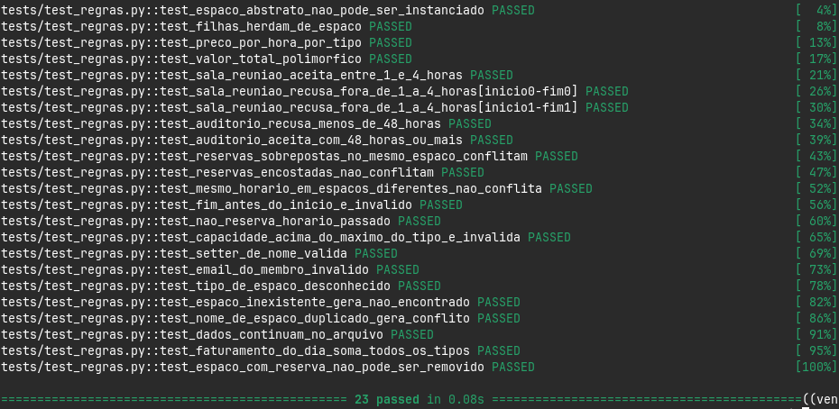
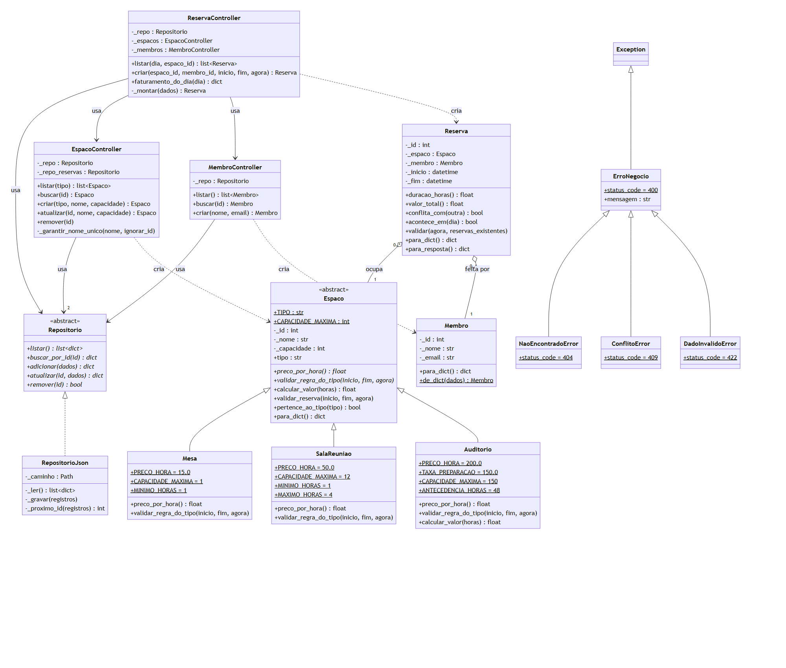

# 🏢 API - Sistema de Coworking

Este projeto é o backend de um sistema de gestão de **Coworking**, desenvolvido como avaliação final para a disciplina de Programação Orientada a Objetos (FATEC Mogi das Cruzes). A aplicação segue uma arquitetura em 4 camadas (`data`, `models`, `controllers` e `routes`), aplicando conceitos avançados de POO como classe abstrata (`ABC`), herança, polimorfismo, encapsulamento, composição, exceções próprias e persistência em arquivos JSON.

<p align="center">
  
  
  
  
  
  
  
  
</p>

---

## 📁 Estrutura do Repositório

```text
├── api-coworking/
│   ├── app/
│   │   ├── controllers/
│   │   ├── data/
│   │   ├── models/
│   │   └── routes/
│   └── tests/
├── documentacao/
├── LICENSE
└── README.md
```

---

## 🚀 Como Rodar o Projeto

Para executar a API localmente, siga os passos abaixo:

1. **Clone o repositório:**
   ```bash
   git clone <URL_DO_REPOSITORIO>
   ```

2. **Acesse a pasta da API:**
   Entre no diretório onde o código-fonte da aplicação está localizado:
   ```bash
   cd <NOME_DO_REPOSITORIO>/api-coworking
   ```

3. **Crie e ative um ambiente virtual (recomendado):**
   * No Windows:
     ```bash
     python -m venv venv
     venv\Scripts\activate
     ```
   * No Linux/Mac:
     ```bash
     python3 -m venv venv
     source venv/bin/activate
     ```

4. **Instale as dependências:**
   ```bash
   pip install -r requirements.txt
   ```

5. **Inicie o servidor local:**
   ```bash
   uvicorn main:app --reload
   ```

6. **Acesse a documentação interativa (Swagger):**
   * Abra o navegador em: [http://127.0.0.1:8000/docs](http://127.0.0.1:8000/docs)

---

## 🧪 Testes Automatizados

Os testes unitários e de regras de negócio foram desenvolvidos com `pytest`. Para executá-los, rode o comando abaixo na raiz da pasta `api-coworking`:

```bash
pytest
```

**Saída dos testes:**



---

## 🏗️ Diagrama de Classes

Abaixo está o diagrama UML representando a classe abstrata `Espaco` e suas especializações (`Mesa`, `SalaReuniao` e `Auditorio`), além da composição realizada pela classe `Reserva` ao associar `Espaco` e `Membro`.



---

## ⚙️ Regras de Negócio e Tratamento de Erros

* **Polimorfismo e Herança:** Cada tipo de espaço (`Mesa`, `SalaReuniao`, `Auditorio`) herda da classe abstrata `Espaco` e implementa seu próprio cálculo de valor por hora.
* **Restrições de Reserva:**
  * Salas de reunião só podem ser reservadas por períodos de **1 a 4 horas**.
  * Auditórios exigem reserva com no mínimo **48 horas de antecedência**.
  * Não são permitidas reservas com conflito de horário para o mesmo espaço.
* **Persistência em Arquivo:** Os dados são armazenados localmente em arquivos `.json` através do `RepositorioJson`, mantendo o estado mesmo após reiniciar o servidor.
* **Exceções Próprias:** Erros de domínio são capturados e convertidos adequadamente nas rotas (`NaoEncontrado` $\rightarrow$ `404`, `Conflito` $\rightarrow$ `409`, `DadoInvalido` $\rightarrow$ `422`).

---

## 🌐 Tabela de Rotas

O sistema expõe rotas RESTful para gerenciamento de espaços, membros, reservas e cálculo de faturamento:

| Método | Rota | Descrição | Retorno de Sucesso | Possíveis Erros |
| :--- | :--- | :--- | :--- | :--- |
| **GET** | `/api/espacos` | Lista todos os espaços cadastrados (aceita filtro opcional `?tipo=`). | `200 OK` | `422 Unprocessable Entity` |
| **GET** | `/api/espacos/{id}` | Busca os detalhes de um espaço específico pelo seu ID. | `200 OK` | `404 Not Found` |
| **POST** | `/api/espacos` | Cadastra um novo espaço (`mesa`, `sala_reuniao` ou `auditorio`). | `201 Created` | `409 Conflict`, `422 Unprocessable Entity` |
| **GET** | `/api/membros` | Lista todos os membros cadastrados no coworking. | `200 OK` | - |
| **GET** | `/api/membros/{id}` | Busca os detalhes de um membro específico pelo seu ID. | `200 OK` | `404 Not Found` |
| **POST** | `/api/membros` | Cadastra um novo membro. | `201 Created` | `409 Conflict`, `422 Unprocessable Entity` |
| **GET** | `/api/reservas` | Lista todas as reservas registradas. | `200 OK` | - |
| **POST** | `/api/reservas` | Registra uma nova reserva validando regras de tempo e conflitos. | `201 Created` | `404 Not Found`, `409 Conflict`, `422 Unprocessable Entity` |
| **PATCH** | `/api/reservas/{id}` | Atualiza informações de uma reserva existente. | `200 OK` | `404 Not Found`, `409 Conflict`, `422 Unprocessable Entity` |
| **DELETE** | `/api/reservas/{id}` | Remove/cancela uma reserva pelo seu ID. | `204 No Content` | `404 Not Found` |
| **GET** | `/api/reservas/faturamento` | Calcula o faturamento total das reservas em uma data específica (`?data=`). | `200 OK` | `422 Unprocessable Entity` |

---

## 📋 Documentação e Gestão

* **Documento Técnico (Google Docs):** [Link para o documento do grupo](#)
* **Quadro Kanban:** [Link para o Kanban do repositório](https://github.com/users/RyanSS27/projects/1)

---

## 👥 Integrantes e Funções

- **Jonathan**: Desenvolvimento da camada `Models` (`Espaco`, `Mesa`, `SalaReuniao`, `Auditorio`, `Membro`, `Reserva` e `excecoes.py`) com herança, composição e encapsulamento, além da redação das seções de Regras de Negócio e Decisões de POO na documentação.
- **Kauan**: Implementação da camada `Data` (`Repositorio` e `RepositorioJson`), garantindo a persistência dos dados em arquivos `.json`, além da documentação da arquitetura em camadas.
- **Marcos**: Criação da camada `Controllers` (`espaco_controller.py`, `membro_controller.py` e `reserva_controller.py`), aplicando polimorfismo sem condicionais de tipo e regras de faturamento, além de documentar a lógica dos controladores.
- **Giovane**: Construção da camada `Routes` (`espaco_routes.py`, `membro_routes.py`, `reserva_routes.py` e `schemas.py`), validação com Pydantic e tradução de exceções para códigos HTTP, além do preenchimento das tabelas de rotas e erros no documento.
- **Ryan**: Desenvolvimento dos testes automatizados com `pytest` (`tests/test_regras.py`), gestão do Kanban no GitHub, consolidação do diagrama de classes e estruturação final da documentação (padrão Fatec e Uso de IA).

---

## 📄 Licença

Este projeto está sob a licença [MIT](./LICENSE).
